## 前言

這篇記錄用 VMware 實作 Magento 2.4.9 的安裝過程，所有服務都裝在**同一台主機**，順序如下：
1. 下載 Ubuntu 26.04 LTS
2. 安裝 Nginx 
3. 安裝 PHP 8.5
4. 安裝 MariaDB 、建立資料庫與使用者
5. 安裝 OpenSearch 
6. 安裝 Composer
7. 安裝 Magento
8. 常見問題
9. MariaDB 11.8 升級到 12.3
---

### 1. 下載 Ubuntu 26.04 LTS

從 [Ubuntu 官方載點](https://ubuntu.com/download/server) 下載，裝好後確認版本：

```bash
lsb_release -a
```

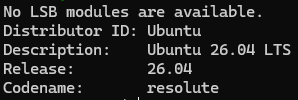

更新 apt 套件

```bash
sudo apt update && sudo apt upgrade -y
sudo apt install software-properties-common
```

### 2. 安裝 Nginx

>**⚠️** Adobe 隨後釋出最新的 Magento 2.4.9 [系統規格](https://experienceleague.adobe.com/en/docs/commerce-operations/installation-guide/system-requirements)，需要 Nginx 1.30

參考：[Install and configure Nginx](https://ubuntu.com/tutorials/install-and-configure-nginx)

```bash
sudo apt update
sudo apt install nginx
nginx -v
```

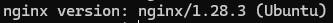


**添加 Nginx 設定檔**（參考：[Configure Nginx for your search engine | Adobe Commerce](https://experienceleague.adobe.com/en/docs/commerce-operations/installation-guide/prerequisites/search-engine/configure-nginx)）

```bash
sudo vi /etc/nginx/sites-available/magento.conf
```

```nginx
upstream fastcgi_backend {
    server unix:/run/php/php8.5-fpm.sock;
}

server {
    listen 80;
    server_name localhost;
    set $MAGE_ROOT /var/www/html/magento2;
    set $MAGE_MODE developer;
    access_log /var/log/nginx/magento2-access.log;
    error_log /var/log/nginx/magento2-error.log;
    include /var/www/html/magento2/nginx.conf.sample;
}
```

設定 Symbolic Link，並重啟 Nginx 服務：

```bash
sudo ln -s /etc/nginx/sites-available/magento.conf /etc/nginx/sites-enabled/
sudo nginx -t
sudo nginx -s reload
```

### 3. 安裝 PHP 8.5

先查看目前 apt 套件的 PHP 版本：

```bash
apt show php
```

若已是 PHP 8.5，直接安裝：

```bash
sudo apt install php-{bcmath,common,curl,fpm,gd,intl,mbstring,mysql,soap,xml,xsl,zip,cli}
```

若低於 PHP 8.5，改用 ondrej 的 PPA 下載：

```bash
sudo add-apt-repository ppa:ondrej/php -y
sudo apt update
sudo apt install php8.5-{bcmath,common,curl,fpm,gd,intl,mbstring,mysql,soap,xml,xsl,zip,cli}
```

檢查 PHP 版本：

```bash
php -v
```

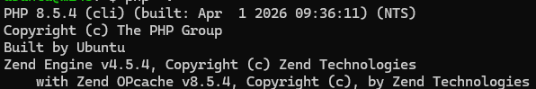

**設定 PHP-FPM**

```bash
sudo vi /etc/php/8.5/fpm/php.ini
```

```ini
memory_limit = 2G
max_execution_time = 1800
zlib.output_compression = On
```

| 用途 | 建議 memory_limit |
|---|---|
| Deploying static assets | 1G |
| Debugging | 2G |
| Testing | 3～4G |

**其他 PHP 設定**（參考：[PHP settings (Adobe Commerce)](https://experienceleague.adobe.com/en/docs/commerce-operations/installation-guide/system-requirements#php-settings)）
```ini
date.timezone = "Asia/Taipei"
realpath_cache_size = 10M
realpath_cache_ttl = 7200
```

重啟 PHP：

```bash
sudo systemctl restart php8.5-fpm
```

### 4. 安裝 MariaDB

>**⚠️** Adobe 隨後釋出最新的 Magento 2.4.9 [系統規格](https://experienceleague.adobe.com/en/docs/commerce-operations/installation-guide/system-requirements)，需要 MariaDB 12.3

確認目前 OS（Ubuntu 26.04）預設的 MariaDB 版本：

```bash
apt show mariadb-server | grep -i version
```

確認安裝後的版本：

```bash
mariadb --version
```

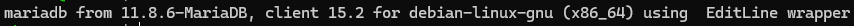

MySQL 用 3306 port 溝通，確認有在監聽：

```bash
sudo ss -tlnp | grep 3306
```

**MariaDB 安全設定**

```bash
sudo mariadb-secure-installation
```

執行時會先出現這段說明：

```text
NOTE: MariaDB is secure by default in Debian. Running this script is
useless at best, and misleading at worst. This script will be
removed in a future MariaDB release in Debian. Please read
/usr/share/doc/mariadb-server/README.Debian.gz for details.
```

| 問題 | 回答 |
|---|---|
| Enter root user password or leave blank | 按 Enter |
| Switch to unix_socket authentication [Y/n] | **n** |
| Change the root password? [Y/n] | **Y**，接著設定密碼 |
| Remove anonymous users? [Y/n] | **Y** |
| Disallow root login remotely? [Y/n] | **Y** |
| Remove test database and access to it? [Y/n] | **Y** |
| Reload privilege tables now? [Y/n] | **Y** |

**建立資料庫與使用者**

```sql
CREATE DATABASE magento;
SHOW DATABASES;

CREATE USER 'mageadmin'@'localhost' IDENTIFIED BY 'mageadmin';
GRANT ALL PRIVILEGES ON magento.* TO 'mageadmin'@'localhost' WITH GRANT OPTION;
```

先給最高權限來安裝 Magento。

### 5. 安裝 OpenSearch

參考：[Debian - OpenSearch Documentation](https://docs.opensearch.org/latest/install-and-configure/install-opensearch/debian/#install-opensearch-from-an-apt-repository)

> **💡 小提醒：** Magento 2.4.9 已棄用 Elasticsearch，搜尋引擎改用 OpenSearch。

```bash
# 建立 keyrings 目錄
sudo mkdir -p /etc/apt/keyrings

# 匯入 GPG 公鑰
curl -fsSL https://artifacts.opensearch.org/publickeys/opensearch-release.pgp \
  | sudo gpg --dearmor -o /etc/apt/keyrings/opensearch.gpg

# 建立 OpenSearch 的 APT repository
echo "deb [signed-by=/etc/apt/keyrings/opensearch.gpg] https://artifacts.opensearch.org/releases/bundle/opensearch/3.x/apt stable main" \
  | sudo tee /etc/apt/sources.list.d/opensearch-3.x.list

# 確認 repository 建立成功，並列出可安裝的版本
sudo apt-get update
sudo apt list -a opensearch
```

選擇版本安裝，密碼自行替換：

> **⚠️ 密碼要求：** 大於 8 個字，需包含大寫英文、小寫英文、數字、符號。

```bash
sudo env OPENSEARCH_INITIAL_ADMIN_PASSWORD='<管理員密碼>' apt-get install opensearch=3.7.0
```

啟用並啟動 OpenSearch：

```bash
sudo systemctl enable opensearch
sudo systemctl start opensearch
sudo systemctl status opensearch
```

測試 9200 port 連線狀況（參考：[Communicate with OpenSearch](https://docs.opensearch.org/latest/getting-started/communicate/#opensearch-rest-api)）：

```bash
curl -ku admin:'<管理員密碼>' https://localhost:9200
```

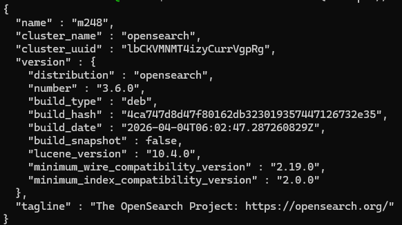

### 6. 安裝 Composer

參考：[How to Install Composer on Ubuntu 26.04, 24.04 and 22.04 - LinuxCapable](https://linuxcapable.com/how-to-install-composer-on-ubuntu-linux/)

> **⚠️ 注意：** 需要升級到 **Composer 2.10**。

確認 apt 上的 Composer 版本是 2.9.3 以上，再安裝：

```bash
sudo apt list -a composer
sudo apt install composer
composer --version
```


### 7. 安裝 Magento

**下載 Magento**

```bash
composer create-project --repository-url=https://repo.magento.com/ \
  magento/project-community-edition=2.4.9 /var/www/html/magento2
```

過程中會要求輸入 Adobe Access Keys。沒有的話請到 [Commerce Marketplace - Access Keys](https://commercemarketplace.adobe.com/customer/account/login/) 註冊。

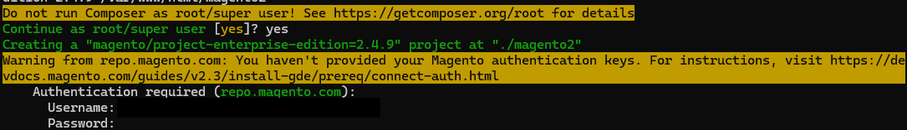

下載成功的畫面：

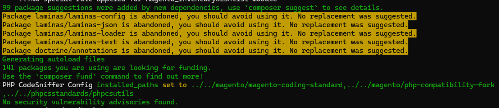

**調整檔案權限**（參考：[Set ownership and permissions for two users](https://experienceleague.adobe.com/en/docs/commerce-operations/installation-guide/prerequisites/file-system/configure-permissions)）

先找出 web server 的使用者群組，Ubuntu 預設應該是 `www-data`：

```bash
ps aux | grep nginx
```

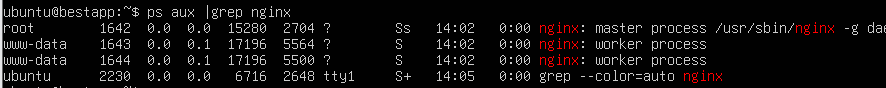

把檔案擁有者加入 web server 群組，確認後重啟 Nginx：

```bash
usermod -a -G www-data <username>
groups <username>
service nginx restart
```

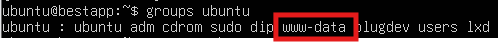

**設定檔案權限**

```bash
cd /var/www/html/magento2
sudo find var generated vendor pub/static pub/media app/etc -type f -exec chmod g+w {} +
sudo find var generated vendor pub/static pub/media app/etc -type d -exec chmod g+ws {} +
sudo chown -R :www-data .
sudo chmod u+x bin/magento
```

**執行安裝**

```bash
sudo php bin/magento setup:install \
  --base-url=http://hsingchuan.com \
  --db-host=localhost \
  --db-name=magento_test \
  --db-user=jim \
  --db-password="jim123" \
  --admin-firstname=admin \
  --admin-lastname=admin \
  --admin-email=admin@admin.com \
  --admin-user=admin \
  --admin-password=admin123 \
  --language=en_US \
  --currency=USD \
  --use-rewrites=1 \
  --search-engine=opensearch \
  --opensearch-host=localhost \
  --opensearch-port=9200 \
  --opensearch-index-prefix=magento2 \
  --opensearch-timeout=15
```

安裝成功畫面：

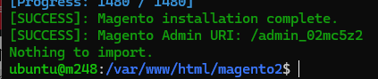

---

## 8. 常見問題

### 8.1 無法找到 OpenSearch 服務

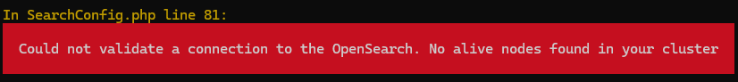

原因是 OpenSearch 預設啟用 Security Plugin。**解決方式：停用 security plugin。**

```bash
sudo vi /etc/opensearch/opensearch.yml
```

添加一行：

```yaml
plugins.security.disabled: true
```

接著重新安裝 Magento。

### 8.2 You need to configure Two-Factor Authorization in order to proceed to your store's admin area

Magento 安裝後，後台預設啟用兩步驟認證。

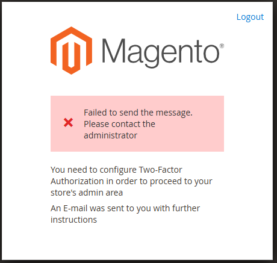

若要改回密碼登入，需關閉相關模組並重新佈署：

```bash
sudo php bin/magento module:disable Magento_TwoFactorAuth Magento_AdminAdobeImsTwoFactorAuth

sudo -u www-data php bin/magento setup:upgrade
sudo -u www-data php bin/magento setup:di:compile
sudo -u www-data php bin/magento setup:static-content:deploy -f
sudo -u www-data php bin/magento indexer:reset
sudo -u www-data php bin/magento indexer:reindex
sudo -u www-data php bin/magento cache:clean
sudo -u www-data php bin/magento cache:flush
```


