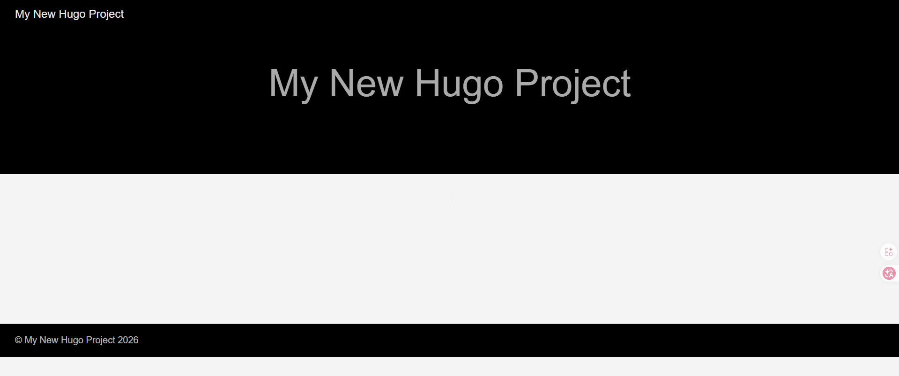

## 前言

最近了解到 **Hugo + GitHub Pages** 可以拿來建置免費的部落格，省去租主機的成本，且文章還可以支援 Markdown。

這篇是照著 Hugo 官方文件做一遍的簡易版 Quickstart，順序如下：
1. 在 Windows 上裝好 Hugo、Git、PowerShell 7
2. 跑官方 Quick Start，在本機 `http://localhost:1313` 看到網站
3. 推上 GitHub
4. 用官方的 GitHub Actions workflow 部署到 GitHub Pages

參考：
- [Install Hugo on Windows](https://gohugo.io/installation/windows/)
- [Hugo Quick Start](https://gohugo.io/getting-started/quick-start/)
- [Host on GitHub Pages](https://gohugo.io/host-and-deploy/host-on-github-pages/)
---

## 1. 環境準備

### 1.1 安裝 Hugo

官方推薦用 Windows 內建的套件管理工具 [WinGet](https://learn.microsoft.com/en-us/windows/package-manager/) 安裝 **extended 版**：

```powershell
winget install -e --id Hugo.Hugo.Extended
```

要移除的話：

```powershell
winget uninstall -e --id Hugo.Hugo.Extended
```
裝完**關掉 PowerShell 再重開**，讓 PATH 生效。

然後確認版本：

```powershell
hugo version
```

看到版本號 ≥ `v0.158.0`，而且有 `+extended` 字樣就可以了。

### 1.2 安裝 Git

```powershell
git --version                  # 沒有的話：winget install Git.Git
git config --global user.name "你的名字"
git config --global user.email "你的 GitHub email"
git config --global init.defaultBranch main
```

最後一行讓之後 `git init` 建立的分支預設叫 `main`，不是 `master`。後面的部署 workflow 只會在 push 到 `main` 時觸發，這行可以省掉一個坑。

### 1.3 改用 PowerShell 7

官方 Quick Start 特別提醒：**不要用「命令提示字元」或 Windows 內建的 Windows PowerShell（5.1）**。

> **⚠️ 為什麼一定要 PowerShell 7：** 5.1 的 `>>` 和 `echo >` 會用 **UTF-16** 編碼寫檔，Quick Start 裡用 `echo` 寫入 `hugo.toml` 的那一步會直接把設定檔弄壞。我就是在這裡卡了兩次，錯誤訊息在下一節。


先確認目前的版本：

```powershell
$PSVersionTable.PSVersion
```

Major 是 `5` 的話，安裝 PowerShell 7：

```powershell
winget install Microsoft.PowerShell
```

裝好後從開始選單開 **PowerShell 7**（黑底圖示），預設路徑是 `C:\Program Files\PowerShell\7\pwsh.exe`。

VS Code 的終端機也順便改成 PowerShell 7：`Ctrl + Shift + P` → **Terminal: Select Default Profile** → 選 **PowerShell**（不要選「Windows PowerShell」）。

或是在 `settings.json` 加一行：

```json
"terminal.integrated.defaultProfile.windows": "PowerShell"
```

---

## 2. Hugo Quick Start

### 2.1 建立專案並套用主題

在 PowerShell 7 執行官方的指令：

```powershell
cd E:\Project\github
hugo new project quickstart
cd quickstart
git init
git submodule add https://github.com/gohugo-ananke/ananke themes/ananke
echo "theme = 'ananke'" >> hugo.toml
hugo server
```

| 指令 | 作用 |
|---|---|
| `hugo new project quickstart` | 建立專案骨架 |
| `git init` | 初始化 git repo |
| `git submodule add ...` | 把 Ananke 主題用**子模組**掛進 `themes/ananke` |
| `echo ... >> hugo.toml` | 在設定檔加上 `theme = 'ananke'` |
| `hugo server` | 啟動本機伺服器，`Ctrl + C` 停止 |

打開 `http://localhost:1313`，看到網站標題就成功了：




### 2.2 專案目錄結構

| 資料夾 / 檔案        | 用途                                  | 常用程度          |
| --------------- | ----------------------------------- | ------------- |
| `archetypes/`   | `hugo new content` 用的文章範本           | 偶爾改           |
| `assets/`       | 需要 Hugo 加工的 CSS、JS、圖片               | 客製化時用         |
| `content/`      | 文章，`content/posts/` 底下每篇 `.md` 就是一頁 | 天天用           |
| `data/`、`i18n/` | 資料檔、多語系翻譯字串                         | 很少用           |
| `layouts/`      | 覆蓋主題的版面                             | 客製化時用         |
| `public/`       | `hugo` build 出來的成品網站                | **不要 commit** |
| `static/`       | 原封不動複製到網站的檔案，例如 favicon             | 偶爾用           |
| `themes/`       | 佈景主題（git submodule）                 | 不要直接改         |
| `hugo.toml`     | 網站設定：標題、主題、選單、語言                    | 偶爾改           |

設定檔支援 `hugo.toml`、`hugo.yaml`、`hugo.json` 三種格式，內容完全一樣，只是寫法不同，**擇一使用**。預設是 TOML，繼續用它就好。

### 2.3 新增文章

```powershell
hugo new content content/posts/my-first-post.md
hugo server -D
```

新文章的 front matter 預設是 `draft = true`，Hugo build 時會跳過草稿，所以預覽要加 `-D`（`--buildDrafts`）。確定要發布時把它改成 `false`。

建議一篇文章一個資料夾（Hugo 稱為 **page bundle**）：封面圖 `cover.png` 跟 `index.md` 放同一層，內文截圖統一放在 `images/`：

```text
content/posts/my-first-post/
  ├─ index.md
  ├─ cover.png
  └─ images/
      └─ architecture.png
```

內文用相對路徑 `` 引用圖片，Obsidian 預覽和 Hugo 網站都能正確顯示。封面放在根目錄、檔名含 `cover` 的話，Hugo 會自動抓它當社群分享縮圖，不用另外設定。

---

## 3. 推上 GitHub

### 3.1 建立 repo

到 [github.com/new](https://github.com/new) 建一個 **Public** 的空 repo，**不要勾** README、.gitignore、license。

### 3.2 先寫好 .gitignore

**`public/` 是 build 出來的成品，不要 commit**，GitHub Actions 會在雲端自己 build。在專案根目錄建立 `.gitignore`：

```text
public/
resources/_gen/
.hugo_build.lock
```

### 3.3 commit 並 push

```powershell
git add .
git status
git commit -m "init hugo blog"
git branch -M main
git remote add origin https://github.com/<帳號>/<repo名稱>.git
git push -u origin main
```

---

## 4. 用 GitHub Actions 部署到 GitHub Pages

這一節照官方 [Host on GitHub Pages](https://gohugo.io/host-and-deploy/host-on-github-pages/) 的步驟做。

### 4.1 Pages 來源改成 GitHub Actions

repo 的 **Settings → Pages → Build and deployment → Source** 選 **GitHub Actions**。不要選「Deploy from a branch」，那是舊做法。頁面跳出的建議 workflow 範本不用點。

### 4.2 加入官方 workflow

在專案根目錄建立 `.github/workflows/hugo.yaml`。下面是官方提供的檔案，我只把 `TZ` 改成台灣時區。

### 4.3 設定圖片快取位置

官方 Step 3 要在 `hugo.toml` **最後面**加上：

```toml
[caches.images]
  dir = ':cacheDir/images'
```

Hugo 處理過的圖片（縮圖、轉檔）預設快取在專案裡的 `resources/_gen/images/`，不在 workflow 的 `Cache restore` / `Cache save` 範圍內。改到 `cacheDir` 之後，每次部署都能沿用上一次的結果，build 會比較快。

> **⚠️ 注意：** `[caches.images]` 這種段落一定要放在檔案最後。放在 `theme = ...` 前面的話，後面的設定會被當成這個段落的子設定。

### 4.4 push 並確認部署

```powershell
git add .
git commit -m "Deploy to GitHub Pages"
git push
```

到 repo 的 **Actions** 分頁，等「Build and deploy」變綠燈（大約 1～2 分鐘）。如果 push 時 Pages 還沒設成 GitHub Actions，workflow 會失敗，設好之後到 **Actions → Build and deploy → Run workflow** 手動再跑一次就好。

### 4.5 打開網站

回到 **Settings → Pages**，最上面會顯示：

```text
Your site is live at https://<帳號>.github.io/<repo>/
```

點進去就是剛剛在本機看到的網站，任何人都能用這個網址瀏覽。之後每次 `git push` 到 `main`，網站都會自動重新 build 和部署。

> **💡 baseURL 不用自己改：** `hugo.toml` 裡的 `baseURL = 'https://example.org/'` 可以先不管。workflow 的 `configure-pages` 會取得 Pages 的實際網址，build 時用 `--baseURL` 帶進去，所以 CSS 和連結都會指向正確的 `github.io` 網址。

> **⚠️ 文章沒出現？** 先檢查三件事：front matter 是不是還是 `draft: true`、`date` 是不是晚於現在時間、Actions 是不是綠燈。

---

## 小結：本機用 hugo server 預覽，push 到 main 就自動上線

整個流程濃縮成三句話：

- **本機**：Hugo extended + Git + **PowerShell 7**，`hugo server -D` 在 `localhost:1313` 預覽
- **版控**：`public/` 不 commit，分支用 `main`，主題用 git submodule 管理
- **部署**：Pages 來源選 GitHub Actions，官方 `hugo.yaml` 放在 `.github/workflows/`，push 之後到 `https://<帳號>.github.io/<repo>/` 就能看到

目前網站還是 Quick Start 的 Ananke 示範主題。下一步會挑選適合技術部落格的佈景主題（程式碼複製按鈕、目錄、搜尋、深色模式），並把 Obsidian 接上 Hugo，讓寫筆記和發文章變成同一件事。
